# Diseño de circuitos y PCB con Altium Designer

En esta práctica diseñamos la tarjeta **Reloj de mesa** en Altium Designer. La placa sirve como módulo de expansión para un microcontrolador. Integra un sensor de temperatura, tres pulsadores y un zumbador. El controlador recibe la temperatura por I²C y el estado de los pulsadores, y acciona la alerta sonora con la señal `BUZZER_EN`.

---

??? abstract "Explorar esta guía"

    - [Datos de la placa](#datos-de-la-placa)
    - [Instalación y entorno](#instalacion-y-entorno)
    - [Proyecto y documentos](#proyecto-y-documentos)
    - [Bibliotecas y componentes](#bibliotecas-y-componentes)
    - [Editor de esquemas](#editor-de-esquemas)
    - [Validación eléctrica](#validacion-electrica)
    - [Transferencia a la PCB](#transferencia-a-la-pcb)
    - [Preparación de la placa](#preparacion-de-la-placa)
    - [Diseño y ruteo](#diseno-y-ruteo)
    - [Perforaciones y planos de cobre](#perforaciones-y-planos-de-cobre)
    - [Verificación final](#verificacion-final)
    - [Archivos de fabricación](#archivos-de-fabricacion)

## Datos de la placa {#datos-de-la-placa}

| Dato | Diseño documentado |
| --- | --- |
| Práctica | Reloj de mesa |
| Proyecto | `Proyecto_Final.PrjPcb` |
| Esquema y placa | `Proyecto_Final.SchDoc` y `Proyecto_Final.PcbDoc` |
| Versión | Altium Designer 26.11.1, compilación 5 |
| Alimentación | `+3V3` desde el controlador conectado a J2/J3 |
| Contorno guardado | Rectangular, **77.216 × 65.913 mm** (ancho × alto) |
| Capas de señal | **Top Layer** y **Bottom Layer**, con ruteo en ambas |
| Estado de la evidencia | Diseño y DRC documentados. Salida NC Drill disponible. |

## Instalación y entorno {#instalacion-y-entorno}

=== "Acceso al programa"

    Para reproducir la práctica, utiliza la instalación oficial de Altium Designer y activa la licencia desde **License Management**. En **Help → About** puedes comprobar la versión y el número de compilación. El equipo trabajó con la licencia académica de la Universidad Iberoamericana Puebla.

    [Instalación y administración de Altium Designer](https://www.altium.com/documentation/altium-designer/installation-management/installing) · [Gestión de licencias](https://www.altium.com/documentation/altium-designer/installation-management/licensing)

=== "Reconocer la interfaz"

    **Projects** permite cambiar entre el esquema y la PCB del mismo proyecto. **Properties** muestra los ajustes del objeto seleccionado. En la parte inferior del editor de PCB, las pestañas de capas permiten identificar la capa activa y distinguir el cobre de la serigrafía y las capas mecánicas.

    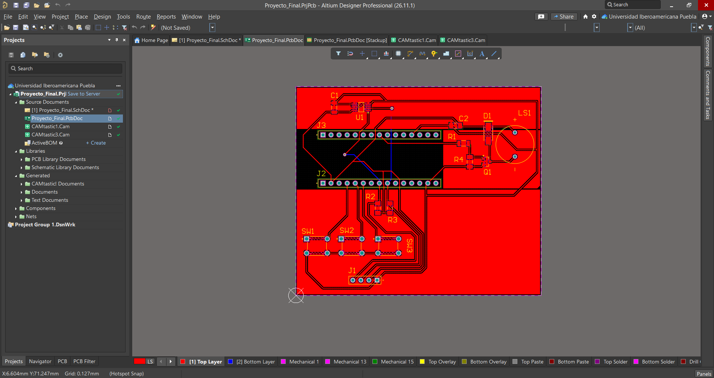

## Proyecto y documentos {#proyecto-y-documentos}

=== "Crear el proyecto"

    1. Abrir **File → New → Project** y elegir un proyecto de PCB.
    2. Asignar un nombre y elegir su ubicación local o el Workspace del equipo.
    3. Agregar el esquema `.SchDoc` y la PCB `.PcbDoc`. Para archivos que ya existen, utilizar **Add Existing to Project**.
    4. Guardar los documentos y comprobar que aparecen en **Source Documents** bajo el mismo `.PrjPcb`.

    [Creación de proyectos y documentos](https://www.altium.com/documentation/altium-designer/creating-projects-documents)

=== "Organización de la práctica"

    El panel **Projects** muestra `Proyecto_Final.PrjPcb` en el Workspace de la Universidad Iberoamericana Puebla. El esquema y la PCB están bajo **Source Documents**, junto a `CAMtastic1.Cam` y `CAMtastic3.Cam`. La carpeta **Libraries** agrupa las bibliotecas asociadas y **Generated** reúne las referencias a salidas del proyecto.

    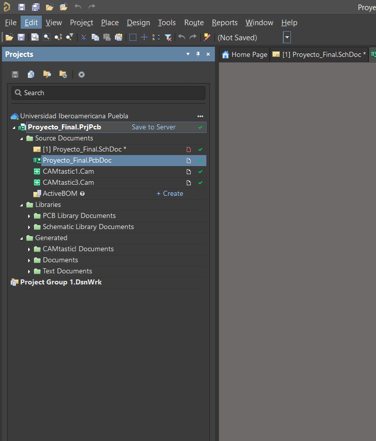

## Bibliotecas y componentes {#bibliotecas-y-componentes}

=== "Origen y huella"

    1. Abrir **Components** y localizar la pieza en la biblioteca disponible.
    2. Colocar el símbolo y seleccionarlo en el esquema para consultar **Properties**.
    3. Revisar **Designator**, **Comment** y **Source**. En **Footprints**, comprobar que el encapsulado y los pads correspondan al componente.

    En el caso de `U1`, **Source** muestra el Workspace de la Universidad Iberoamericana Puebla. El sensor `MCP9808-E/MS` utiliza la huella `MCHP-MSOP-MS8_M`, con ocho terminales y paso de 0.65 mm. En el esquema guardado, `J2` y `J3` usan el símbolo `DS1023-1x15SF11_LOCAL` de `Conectores_Reloj.SchLib`.

    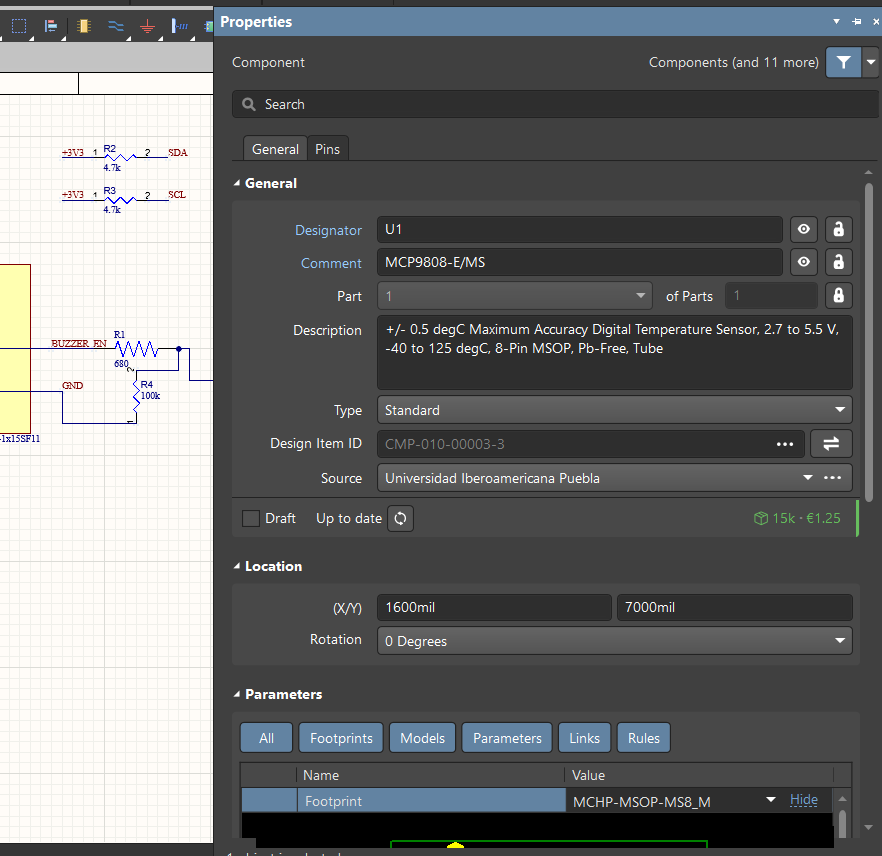

    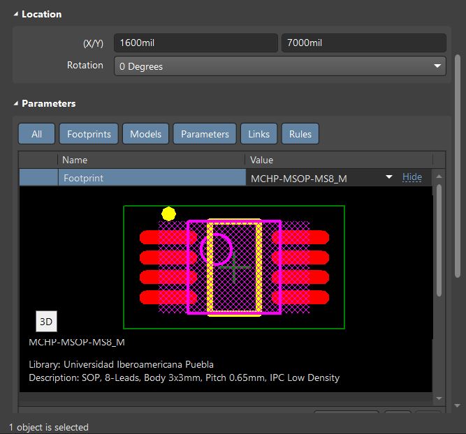

    [Disponibilidad de bibliotecas en Altium](https://www.altium.com/documentation/altium-designer/schematic/components-file-based-database-libraries)

=== "Lista de componentes"

    | Referencia | Componente o valor | Función en la placa |
    | --- | --- | --- |
    | U1 | `MCP9808-E/MS` | Sensor digital de temperatura |
    | J1 | `TSW-104-07-G-S` | Conector auxiliar de alimentación e I²C |
    | J2, J3 | `DS1023-1x15SF11` | Dos conectores de 15 pines para el controlador |
    | SW1, SW2, SW3 | `B3F-1000` | Pulsadores de menú, avance y confirmación |
    | R1 | `RC1206FR-07680RL`, 680 Ω | Resistencia de base de Q1 |
    | R2, R3 | 4.7 kΩ, 1 %, 1206, 250 mW | Resistencias de polarización de `SDA` y `SCL` |
    | R4 | 100 kΩ, 1 %, 1206, 250 mW | Polarización de la base de Q1 hacia tierra |
    | C1 | `CL31B104KBCNNNC`, 100 nF | Desacoplo de alimentación |
    | C2 | 10 µF, 10 %, 16 V, 1206 | Desacoplo de alimentación |
    | LS1 | `KXG1203C` | Zumbador |
    | D1 | `SS12` | Diodo en paralelo con el zumbador |
    | Q1 | `MMBT3904LT1G` | Transistor de conmutación del zumbador |

## Editor de esquemas {#editor-de-esquemas}

=== "Vista general"

    El esquema se organiza en cuatro bloques. El **sensor MCP9808** comunica sus lecturas por `SDA` y `SCL`, con resistencias de 4.7 kΩ hacia `+3V3`. **C1 y C2** están entre `+3V3` y `GND`. Los **pulsadores** cierran su señal a `GND` al presionarlos. El **zumbador** se conecta a `+3V3` y Q1 conmuta su retorno a tierra cuando el controlador activa `BUZZER_EN`.

    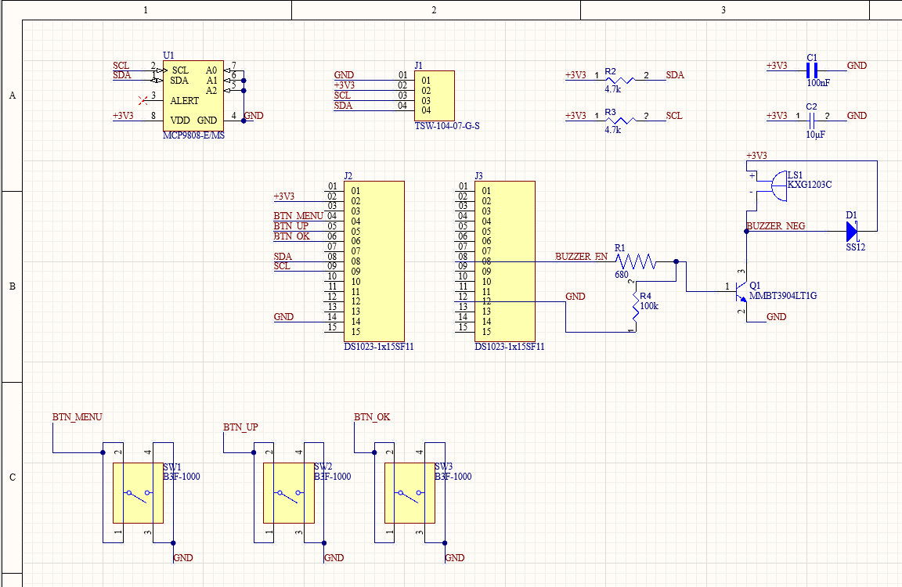

=== "Conectar y etiquetar"

    1. Colocar los símbolos y comprobar que cada uno tenga un designador único.
    2. Usar **Place → Wire** para conectar pines y colocar **Place → Net Label** sobre los cables que requieran un nombre.
    3. Reutilizar las etiquetas en los puntos de la hoja que deban pertenecer a la misma red. Revisar que la etiqueta esté anclada al cable.
    4. Verificar las uniones y las señales en los conectores antes de actualizar la PCB.

    En el esquema completo, `SDA` y `SCL` se pueden seguir desde U1 hasta J1 y J2 por sus etiquetas. Los nombres `BTN_MENU`, `BTN_UP` y `BTN_OK` vinculan J2 con SW1, SW2 y SW3. El estado de reposo de las entradas depende de la polarización que use el controlador.

    [Cables y etiquetas de red](https://www.altium.com/documentation/altium-designer/schematic/creating-circuit-connectivity)

=== "Asignación de conectores"

    | Conector | Pines visibles en el esquema | Uso |
    | --- | --- | --- |
    | J1 | 01 `GND`, 02 `+3V3`, 03 `SCL`, 04 `SDA` | Expansión auxiliar |
    | J2 | 02 `+3V3`, 04 `BTN_MENU`, 05 `BTN_UP`, 06 `BTN_OK`, 08 `SDA`, 09 `SCL`, 14 `GND` | Alimentación, pulsadores y bus I²C |
    | J3 | 08 `BUZZER_EN`, 12 `GND` | Control del zumbador y retorno |

## Validación eléctrica {#validacion-electrica}

1. En el panel **Projects**, seleccionar el proyecto y ejecutar **Validate PCB Project**.
2. Abrir **Messages** y revisar cada entrada asociada al esquema.
3. Para la advertencia de `SCL`, revisar el tipo eléctrico de los pines implicados y cómo se representa el controlador externo en el circuito.

!!! warning "Resultado de la validación del esquema"

    El panel **Messages** informa una compilación con **cero errores** y muestra **una advertencia** para `SCL`. Altium indica que la red carece de una fuente que la maneje. El esquema lleva `SCL` a J2-09 y a U1. Queda por confirmar el manejo del reloj desde el controlador y la causa de la advertencia en la configuración eléctrica.

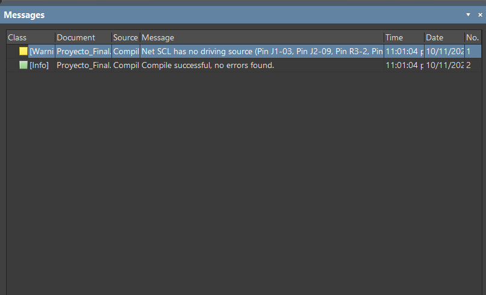

[Validación eléctrica del proyecto](https://www.altium.com/documentation/altium-designer/schematic/design-validation)

## Transferencia a la PCB {#transferencia-a-la-pcb}

1. Guardar el `.SchDoc` y el `.PcbDoc` dentro del proyecto.
2. Con el esquema activo, abrir **Design → Update PCB Document** si se necesita sincronizar cambios.
3. Cuando aparezca una **Engineering Change Order (ECO)**, revisar huellas, componentes y redes. Usar **Validate Changes** y luego **Execute Changes** para aplicar los cambios revisados.
4. Comprobar en la PCB que los designadores coincidan con el esquema y que las redes estén asignadas a sus pads.

La sincronización mediante ECO queda como referencia para futuras revisiones. La evidencia de esta práctica muestra los documentos asociados y la distribución final de la PCB. [Sincronización entre esquema y PCB](https://www.altium.com/documentation/altium-designer/sch-pcb)

## Preparación de la placa {#preparacion-de-la-placa}

=== "Capas"

    Abrir **Design → Layer Stack Manager** y revisar **Stackup**. La configuración del proyecto tiene dos capas de señal de cobre de **1 oz**, cada una con **0.03556 mm** de espesor. Entre ellas aparece `Dielectric 1`, con material FR-4 y **0.32004 mm** configurados. `Top Solder` y `Bottom Solder` corresponden a las máscaras de soldadura. `Top Overlay` y `Bottom Overlay` son capas de serigrafía.

    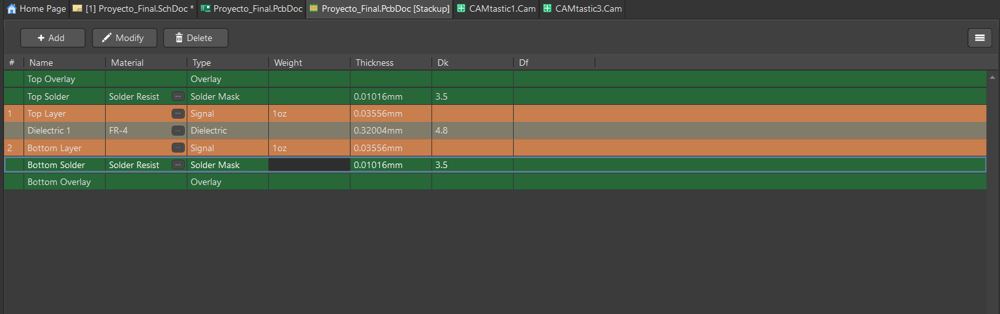

    [Configuración de capas](https://www.altium.com/documentation/altium-designer/pcb/defining-layer-stack)

=== "Contorno y medidas"

    1. Definir el contorno físico con **Board Shape**. Verificar que el perímetro sea cerrado.
    2. En 2D, abrir **Reports → Measure Distance** (`Ctrl+M`). Medir el ancho y el alto con los puntos ajustados a los vértices del contorno.
    3. Registrar la componente **X Distance** para el ancho y **Y Distance** para el alto. Para una medición horizontal o vertical, verificar que el desplazamiento en el otro eje sea cero.

    El contorno rectangular guardado en `Proyecto_Final.PcbDoc` abarca **3040 × 2595 mil**, equivalentes a **77.216 × 65.913 mm**. Las capturas muestran una lectura horizontal de **77.216 mm** con un desplazamiento vertical de **0.127 mm** y una lectura vertical de **65.659 mm**. La lectura vertical corresponde a los puntos seleccionados en la captura. Para especificar la placa se toman los vértices del contorno guardado.

    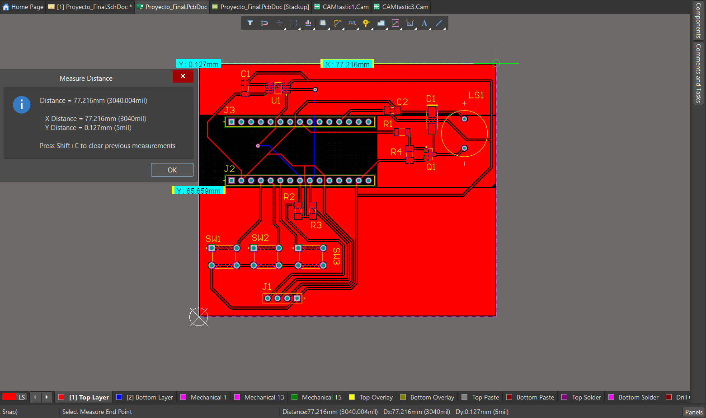

    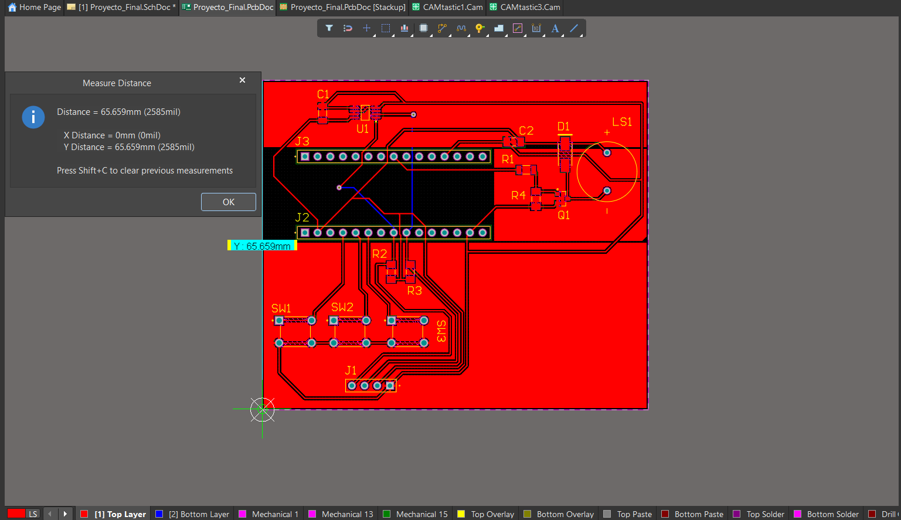

    [Definir el contorno](https://www.altium.com/documentation/altium-designer/pcb/defining-board-shape) · [Medir distancias](https://www.altium.com/documentation/altium-designer/pcb/measuring-distances)

=== "Distribución de componentes"

    J2 y J3 ocupan dos filas paralelas en la zona central. El sensor U1 queda hacia el borde superior y el zumbador LS1 hacia la derecha, junto a su etapa de control. Los pulsadores se alinean debajo de J2 y J1 queda cerca del borde inferior. Esta distribución permite identificar cada bloque del esquema en el diseño físico.

## Diseño y ruteo {#diseno-y-ruteo}

=== "Reglas de diseño"

    Con la PCB activa, abrir **Design → Rules**. En **Routing → Width**, comprobar el alcance y los límites por capa. La regla `Width` de esta placa muestra **0.089 mm** de mínimo, **0.381 mm** como valor preferido y **2.54 mm** de máximo en ambas capas de señal.

    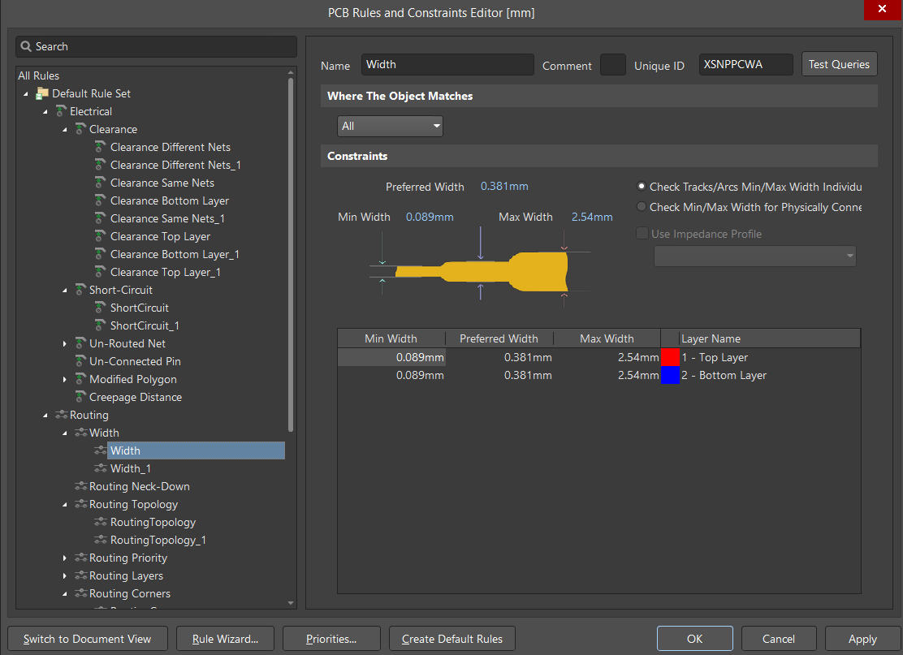

    En **Electrical → Clearance**, la regla `Clearance Different Nets` muestra separaciones según los objetos. La matriz indica **0.089 mm** entre pistas y **0.2 mm** entre una pista y un pad pasante. El reporte DRC también lista restricciones de **0.203 mm** con alcance por capa. Para interpretar una separación se debe revisar qué regla aplica al par de objetos evaluado.

    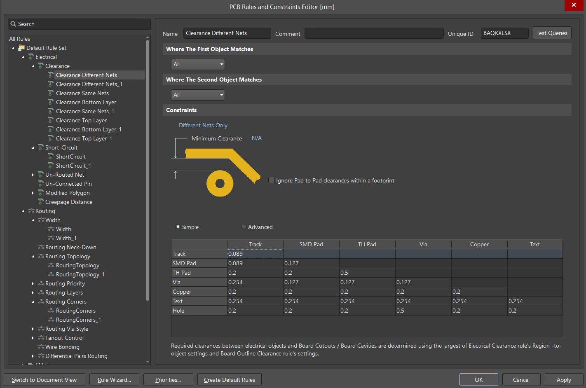

    [Reglas en el editor de PCB](https://www.altium.com/documentation/altium-designer/pcb/constraints-editor)

=== "Trazado de pistas"

    1. Activar la capa de señal prevista e iniciar **Route → Interactive Routing**.
    2. Seleccionar un pad y llevar la pista hasta el destino de su red, respetando la separación y el ancho de la regla aplicable.
    3. Revisar en **Properties** la red, capa y ancho del segmento seleccionado. Comprobar los cambios de capa y las conexiones pendientes en el DRC.

    En la PCB ruteada, las pistas rojas corresponden a **Top Layer** y las azules a **Bottom Layer**. La pista seleccionada en el segundo ejemplo pertenece a `+3V3`, está en **Top Layer** y mide **0.381 mm** de ancho y **12.393 mm** de largo en ese segmento.

    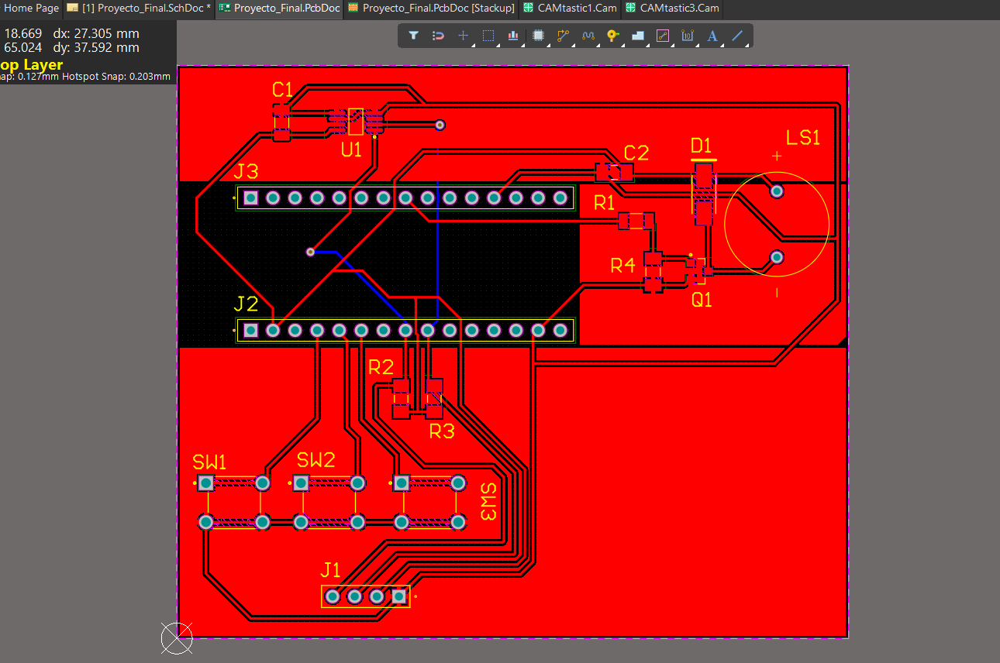

    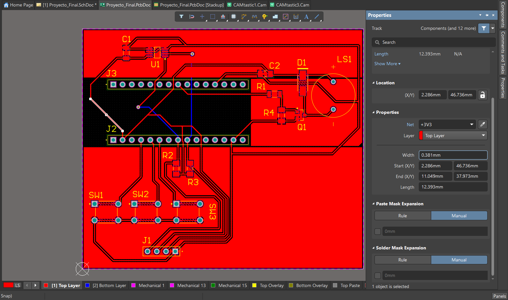

    [Ruteo interactivo](https://www.altium.com/documentation/altium-designer/pcb/routing/interactive)

=== "Identificación en serigrafía"

    Seleccionar un designador y revisar su posición, tamaño y capa en **Properties**. En el ejemplo, `J2` está en **Top Overlay** con una altura de **1.524 mm** y un grosor de trazo de **0.254 mm**. Colocar las referencias cerca de sus componentes para que la serigrafía permita identificarlos durante el montaje.

    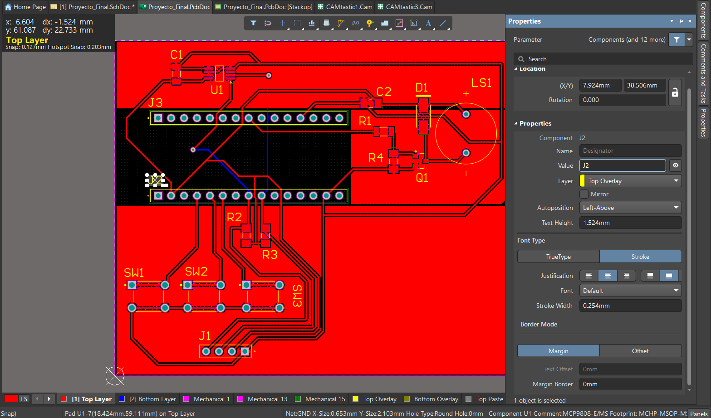

## Perforaciones y planos de cobre {#perforaciones-y-planos-de-cobre}

=== "Perforaciones"

    Para revisar una perforación, seleccionar el pad o la vía en el editor y consultar su diámetro de agujero en **Properties**. El reporte `Proyecto_Final.DRR` agrupa las herramientas de la salida **NC Drill** entre **Top Layer** y **Bottom Layer**. Registra **50 perforaciones redondas metalizadas**.

    | Herramienta | Diámetro | Cantidad |
    | --- | --- | --- |
    | T01 | 0.500 mm | 2 |
    | T02 | 0.900 mm | 2 |
    | T03 | 1.020 mm | 34 |
    | T04 | 1.200 mm | 12 |

    [Propiedades de pads y agujeros](https://www.altium.com/documentation/altium-designer/pcb/understanding-connectivity)

=== "Planos de cobre"

    La PCB guardada contiene tres polígonos sólidos de `GND` en **Top Layer**. Se distinguen como regiones rojas alrededor del sensor, el zumbador y la zona de los pulsadores en la vista ruteada.

    Para reproducir esta etapa, colocar un **Polygon Pour**, seleccionar la capa y asignar la red `GND` en **Properties**. Después de editar las pistas, usar **Repour** para recalcular el relleno y revisar sus conexiones y separaciones antes del DRC. [Polígonos en capas de señal](https://www.altium.com/documentation/altium-designer/pcb/signal-layer-polygons)

## Verificación final {#verificacion-final}

=== "Resultado del DRC"

    1. Guardar la PCB con los rellenos actualizados.
    2. Abrir **Tools → Design Rule Check**, seleccionar las comprobaciones y activar la generación del reporte.
    3. Ejecutar la revisión y comprobar las entradas del resumen.

    El reporte de `Proyecto_Final.PcbDoc` del **10 de noviembre de 2026** registra **0 advertencias y 0 violaciones** en las reglas ejecutadas. El archivo de reporte incluye comprobaciones de aislamiento, cortocircuitos, conexiones sin rutear y anchos de pista.

    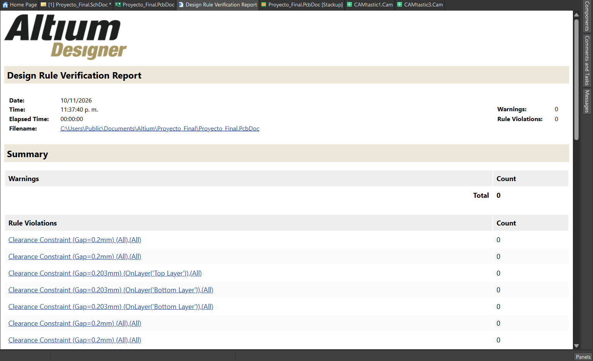

    [Comprobación DRC](https://www.altium.com/documentation/altium-designer/tutorial/verifying-board-design)

=== "Inspección 3D"

    Con el `.PcbDoc` activo, presionar `3` para abrir la vista 3D. Revisar el contorno, la orientación, la posición de los pulsadores y el acceso a los conectores. La captura muestra los tres pulsadores y varios componentes SMD con sus modelos. Las posiciones de J1, J2, J3 y LS1 se identifican por sus huellas y marcas de serigrafía.

    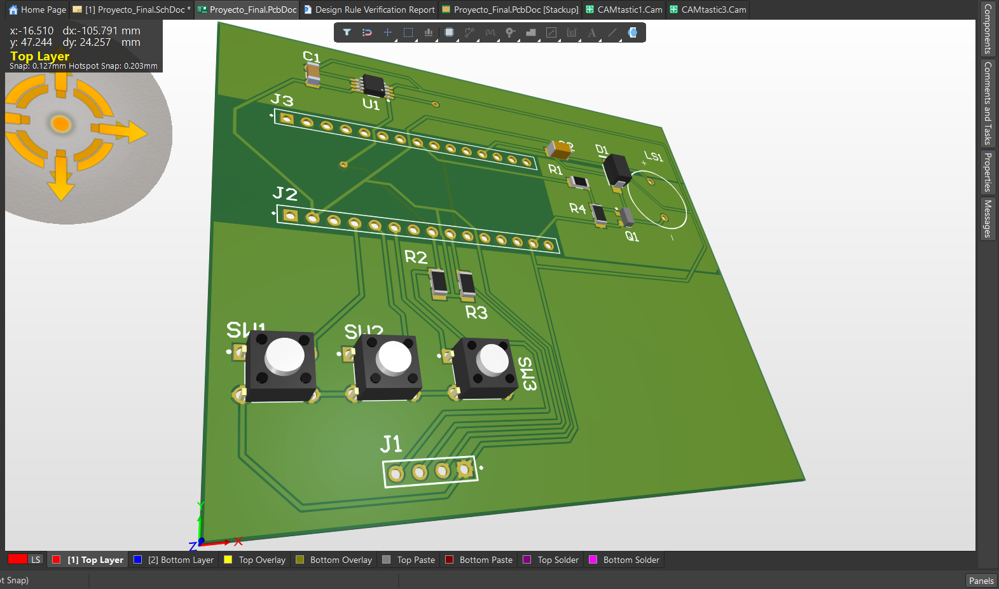

    [Vista 3D de la placa](https://www.altium.com/documentation/altium-designer/pcb/3d-view)

## Archivos de fabricación {#archivos-de-fabricacion}

=== "Salidas del proyecto"

    Desde el `.PcbDoc`, **File → Fabrication Outputs → Gerber Files** permite seleccionar las capas de cobre y el perfil de la placa. **NC Drill Files** genera el archivo de perforaciones. Para verificar las salidas, abrirlas en un visor CAM y superponer el cobre superior, el inferior, el perfil y los agujeros. [Preparación de datos de fabricación](https://www.altium.com/documentation/altium-designer/preparing-for-manufacture/output-jobs/fabrication-data)

    | Evidencia disponible | Detalle |
    | --- | --- |
    | `Proyecto_Final-Plated.TXT` | Salida NC Drill métrica con formato 4:4 y cuatro herramientas para agujeros metalizados. |
    | `Proyecto_Final.DRR` | Reporte de diámetros y cantidades del taladrado. |
    | `CAMtastic1.Cam` y `CAMtastic3.Cam` | Documentos CAM del proyecto. Entre sus referencias aparecen `Proyecto_Final.GTL`, `Proyecto_Final.GBL`, `Proyecto_Final.GM` y `Proyecto_Final-Plated.TXT`. |

=== "Revisión en CAM"

    Para cerrar esta etapa queda por reunir el juego Gerber de la revisión final y comprobar visualmente la coincidencia entre cobre, perfil y perforaciones. Se debe confirmar el método de fabricación de esta placa. Si se emplea la fresadora con Mods, se documentará también el formato de entrada, la conversión utilizada y la comprobación de escala en el programa.
