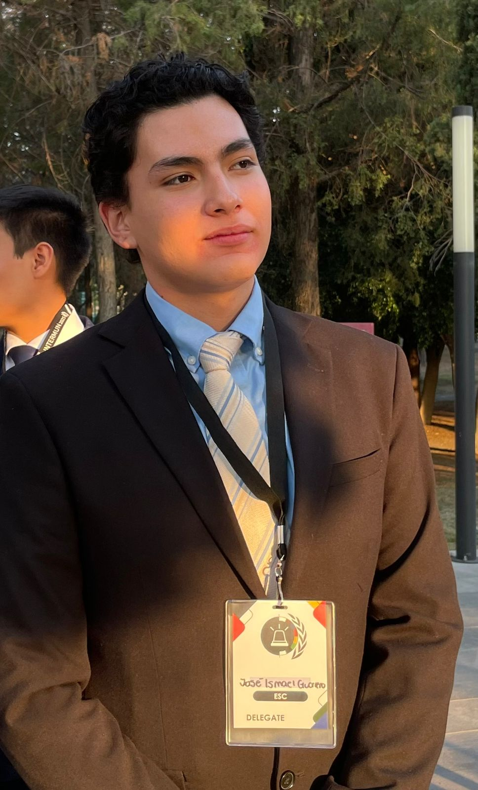
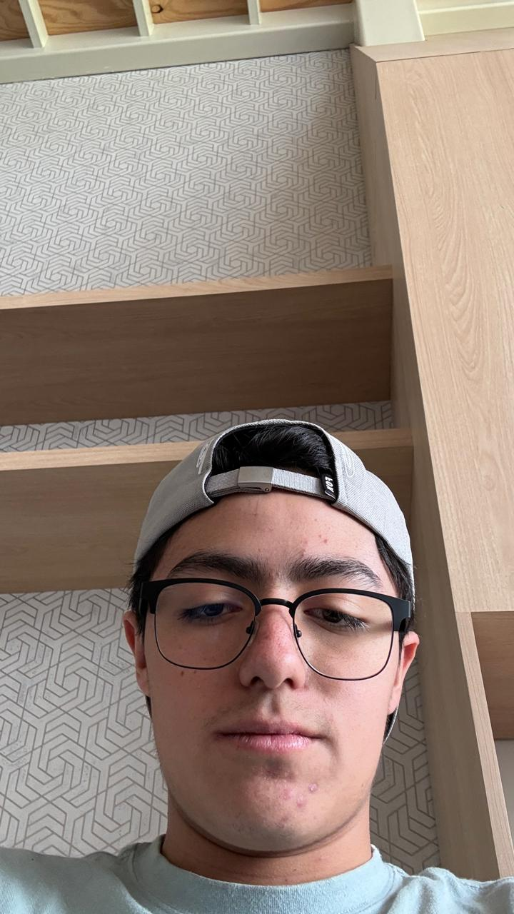

# Equipo de trabajo

Conócenos, equipo de trabajo en Producción Electrónica.

<section class="profile-card" markdown="1">

## José Ismael Guerrero Román

- **Carrera:** Ing Mecatrónica, 3er Semestre 
- **Edad:** 19
- **Cumpleaños:** 23 Julio
- **Contacto:** [203563@iberopuebla.mx](mailto:203563@iberopuebla.mx)
- [LinkedIn](https://www.linkedin.com/in/josé-ismael-guerrero-romàn-80b4b9438?utm_source=share_via&utm_content=profile&utm_medium=member_ios){ .md-button target="_blank" rel="noopener noreferrer" }

??? note "Más sobre mí"

    **Intereses**

    Me gusta jugar videojuegos, escuchar música y estar informado de la tecnología y de los avances que logramos con ella y finalmente, otro de mis gustos es la fórmula 1.

    **Lo que me enorgullece**

    Estoy Orgulloso, de como he crecido como persona a lo largo del tiempo y de como a pesar de mis errores y aciertos en la vida he podido, levantarme y aprender algo aunque sea mínimo, de las personas que me rodean y como en ocasiones he podido llegar a influir positivamente en ellos, tanto como amigos y familia, de igual manera estoy orgulloso, de haber podido mantener una buena trayectoria académica a lo largo de mis estudios y de poder seguir estudiando en esta etapa de mi vida.

</section>

<section class="profile-card" markdown="1">

## Gerardo Esquivel De Luna

  

- **Carrera:** Ing Mecatrónica, 3er semestre 
- **Edad:** 19
- **Cumpleaños:** 18 Julio
- **Contacto:** [204655@iberopuebla.mx](mailto:204655@iberopuebla.mx)
- [LinkedIn](https://www.linkedin.com/in/gerardo-esquivel-0b0838438){ .md-button target="_blank" rel="noopener noreferrer" }

??? note "Más sobre mí"

    **Intereses**

    videojuegos, música, ciclismo.

    **Lo que me enorgullece**

    De ser una persona perseverante, que no se rinde fácilmente, por haber superado momentos difíciles y seguir avanzando y por ser alguien que ayuda a los demás cuando lo necesitan.

</section>

